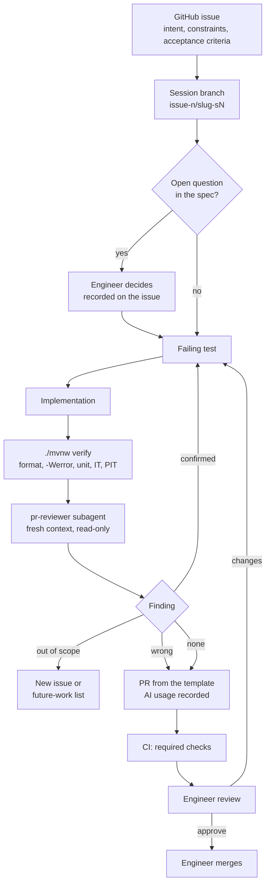

# AI usage

This page covers how AI was used to build this service, what kept it in check, and where it went
wrong. Claims link to the pull request that records them. Each PR's description holds the full
record:
AI usage by activity, what was generated, edited or rejected, the key prompts, every subagent
run and how its findings were triaged, and verification for each acceptance criterion.

The assistant was Claude Code. The engineer chose the scope, made every decision put to them,
reviewed every PR, and made or authorized every commit, push and merge.

## Contents

1. [The workflow](#the-workflow), including [the engineer's personal skills](#the-engineers-personal-skills)
2. [Guardrails and their limits](#guardrails-and-their-limits)
3. [Subagent roles](#subagent-roles)
4. [Pitfalls and countermeasures](#pitfalls-and-countermeasures)
5. [Rejected and corrected AI output](#rejected-and-corrected-ai-output)
6. [Labeled experiment: does constraining the output matter?](#labeled-experiment-does-constraining-the-output-matter)

## The workflow

Requirements started as a PRD ([#1][i1]), which was sliced into issues that each cut through
every layer. Every issue uses the committed
[issue template](../.github/ISSUE_TEMPLATE/work-item.md): intent, constraints, technical context,
acceptance criteria, blockers, and where a subagent could help.

- **One issue per session.** A session works on exactly one issue, on a branch named
  `issue-{n}/{slug}-s{session}`. `PROGRESS.md` is the hand-off between sessions; full history lives
  in the issues and PRs. Anything found outside the issue's scope became a new issue (#11, #17,
  #19, #31, #35) or, once the backlog was frozen ([PR #34][pr34]), a line on the future-work
  list.
- **Decisions go to the engineer.** Open questions were put to the engineer as explicit choices
  with evidence and a recommendation, not settled by the assistant. Examples: the 12 open
  questions on the URL policy ([PR #20][pr20]), the 8 on click analytics ([#8][i8comment]), the
  meaning of "reliable" ([#9][i9decisions]), and keeping create's transaction ([PR #40][pr40]).
- **Test first, as a committed rule.** The engineer's test-driven practice is written into
  `CLAUDE.md` rule 2 and the PRD's testing decisions: a failing test before every behavior and
  every bug fix, tests through public interfaces, and no mocking of internal collaborators. Every
  session follows it from the repository itself. Where a new test passed immediately, the code it
  protects was deliberately broken to show that the test could fail ([PR #30][pr30],
  [PR #37][pr37]).
- **Independent review before the engineer's.** `pr-reviewer` reviewed every PR with fresh
  context. Its "suspected" findings were reproduced before anything was changed.
- **The PR is the audit record.** The committed [PR template](../.github/pull_request_template.md)
  is filled in while the work happens, not reconstructed afterwards.
- **Parallel work was the exception.** Some background work ran in parallel with the active
  issue, each agent in its own git worktree: read-only analysis for the next issue, and four
  slices that touched disjoint files (#17, #19, #25, and the docs for #9, whose characterization of
  `v0.1.0` ran in its own worktree and Compose project). The demo page
  (#41) was built by a second session alongside #10, once that session had moved to its own
  worktree (see "Pitfalls" below). At most two issue PRs were open at once.

### The engineer's personal skills

The engineer drove the work with a set of personal Claude Code skills: slash commands that live
in their own Claude configuration, are reused across projects, and are not committed here. The
project-specific rules they rely on are committed in `CLAUDE.md`, `PROGRESS.md` and the
templates. Which skills ran, and in which sessions, was checked against the session transcripts.

| Skill | What it does | How it was used here |
|---|---|---|
| `/grill-me` | Interviews the engineer one question at a time, each with a recommended answer, walking down every branch of a plan until both sides agree | Planning, before the repository existed: settled the stack, scope, URL policy, analytics model, guardrails and phase order. The decisions fed the PRD |
| `/write-a-prd` | Turns that shared understanding into a PRD (problem, solution, user stories, implementation and testing decisions, out of scope) and posts it as an issue only after the engineer confirms | Wrote the PRD, [#1][i1]. A separate AI design review of the PRD followed, and the engineer triaged each finding [on the issue][i1review] |
| `/prd-to-issue` | Breaks a PRD into vertical-slice issues with blockers, and asks the engineer to approve the granularity and dependencies before creating them | Created #2–#10 in dependency order, in the shape of the committed [issue template](../.github/ISSUE_TEMPLATE/work-item.md). While slicing, the scope test cut link expiry, [recorded on #1][i1expiry] |
| `/start-session` | Switches to an up-to-date `main` before reading anything, then reads `PROGRESS.md`, `CLAUDE.md` and the open issues, checks the git state, recommends the next step and the branch name, and waits for the engineer to confirm | Started every working session on this repository, including this one |
| `/end-session` | Labels each acceptance criterion CONFIRMED (observed live), INFERRED or UNVERIFIED, stops for the engineer if any criterion isn't CONFIRMED, updates `PROGRESS.md`, and closes the issue only after explicit confirmation. It never commits, pushes or merges | Closed out sessions from #2 onward. Once `main` was protected, the closing PR's `Closes #n` closed most issues instead, and the `PROGRESS.md` update moved to the next issue's branch |

## Guardrails and their limits

`CLAUDE.md` calls these **guardrails, not guarantees**. Some are enforced by a tool; the rest
are instructions the model can misread or ignore. The engineer's review of every PR is the
control that matters.

| Guardrail | What it does | Enforced by | Limit |
|---|---|---|---|
| [`CLAUDE.md`](../CLAUDE.md) | Project facts, the eight rules (one issue per session, test first, no unverified dependencies, never log secrets or destinations, no secrets in the repo, YAGNI, the engineer commits, high-impact sign-off), workflow, and the Spring Boot 4 idioms confirmed in #2 | The model reading it | Advisory only |
| [`.claude/settings.json`](../.claude/settings.json) `deny` | Blocks reading `.env*` and `secrets/**` | Claude Code's permission system | Covers Claude Code's file tools, not the shell. Shown working in [PR #12][pr12]: the `Read` call was blocked. When asked to `cat .env` through Bash, the model declined on its own; that refusal is advisory, not enforced. Mitigation: no real secrets in the working tree |
| `settings.json` `ask` | Prompts the engineer before `git push`, `gh pr merge`, `gh issue close`, and edits to `pom.xml` or migrations | Claude Code's permission system | Matches command spellings, so a variant such as `git -C . push` is not caught; and the `Edit` rules don't stop a shell command from changing `pom.xml` or a migration |
| Subagent tool lists | `pr-reviewer` has only Read, Grep and Glob; `spec-test-designer` has no shell | Claude Code, when the agent is loaded at session start | `spec-test-designer`'s "don't read the implementation" is an instruction, not a restriction |
| Branch protection on `main` | Every change goes through a PR with four required checks, and the rule applies to admins too | GitHub | Demonstrated in [PR #13][pr13]: a direct push was rejected, and a PR with a red check couldn't be merged |
| CI gates | Formatting (google-java-format), `-Xlint:all -Werror`, unit and integration tests on real PostgreSQL, PIT mutation threshold (85%), gitleaks, CodeQL, the clean-clone compose and smoke run, Dependabot | GitHub Actions; branch protection requires four of the jobs (build and test, gitleaks, the compose and smoke run, CodeQL) | The mutation job fails below 85% but is not a required check, so a red PIT run doesn't block a merge on its own. Formatting, the compiler warning, a failing test and a planted secret were each shown failing on a throwaway PR ([#14][pr14]). The gates catch regressions, not wrong requirements |
| PR template | AI usage by activity, generated/edited/rejected with rationale, prompts, subagent triage, verification per criterion, high-impact sign-off, ownership attestation | Process | Depends on the record being honest; see "Known gaps in the record" below |
| Code-scanning triage rule ([#19][i19], [PR #22][pr22]) | Alerts are never silenced in code. A false positive gets a test pinning the assumption that makes it safe, and only the engineer dismisses it | Process | Advisory |
| Version pinning (rule 3) | Every dependency, plugin, image and action version is checked against an official source and pinned exactly | Process, then Dependabot | Did not stop one stale "latest" claim; a second source caught it ([PR #12][pr12]) |

### Known gaps in the record

- **The template gave the high-impact boxes two meanings.** It said to tick each area a PR
  touches, and that each needs the engineer's sign-off. Its separate "Engineer sign-off" line
  ended in an HTML comment, which GitHub hides, so it read as a label rather than a blank to fill
  in. In the PRs up to [#22][pr22], the engineer ticked every box as their sign-off, including
  areas the PR didn't touch ([PR #20][pr20] ticks all six and then says "None apply"). From
  [PR #23][pr23] on, only the touched areas were ticked. The sign-off line was left blank in every
  PR.
- **Corrected during #10.** In each of those early PRs, the boxes now mark only the areas the
  PR's changed files touch, with a visible note saying so. Every PR's sign-off line now records
  the engineer's approval by merge. The [PR template](../.github/pull_request_template.md) now
  separates "areas this PR touches" from a sign-off checkbox with a visible prompt.
- **The ownership attestation is unticked** in [PR #22][pr22] and [PR #36][pr36]. In
  [PR #20][pr20] it was ticked after merge, during #10.

## Subagent roles

Three project subagents are committed in [`.claude/agents/`](../.claude/agents/). Claude Code's
built-in agents were used for analysis, drafting and parallel slices.

| Subagent | Role | Tools | Where it was used |
|---|---|---|---|
| [`pr-reviewer`](../.claude/agents/pr-reviewer.md) | Reviews a change against its issue and `CLAUDE.md`, with fresh context | Read, Grep, Glob | Every merged PR, from [#12][pr12] to [#42][pr42] (twice on some, such as [#37][pr37] and [#42][pr42]). It found real defects: an auth bypass ([#16][pr16]), a fail-open 401 path ([#18][pr18]), wrong rejection reasons ([#20][pr20]), tests that couldn't fail ([#21][pr21]), a URL echoed into an error ([#30][pr30]), and the flaw in removing create's transaction ([#40][pr40]) |
| [`spec-test-designer`](../.claude/agents/spec-test-designer.md) | Designs tests from the spec only, without reading the implementation | Read, Grep, Glob, Edit, Write | The adversarial URL table (210 cases in the draft, 237 rows once committed) with 12 open questions, drafted during #3 before any policy code existed and used in [PR #20][pr20]; the `ApiDocsIT` tests for [PR #23][pr23] |
| [`reviewer-simulator`](../.claude/agents/reviewer-simulator.md) | Follows only the README in an isolated worktree, like an evaluator with just Docker | Read, Grep, Glob, Bash, PowerShell; worktree isolation | The final check in #10. Following only the README, it started the stack, passed the smoke test, and exercised the demo page, the API examples, a destination rejection, metrics and shutdown. It reported four friction points and two observations: a stats example with fixed dates that showed zero clicks, a metrics query that prints nothing on a healthy stack, ambiguous Compose version wording, no stated way to tell when the stack is ready, harmless Maven warnings during the build, and no command to remove the built image. All six were fixed or documented in the README |
| `Explore` (built-in) | Read-only search and analysis | Read-only | The impact analysis for #8, drafted during #7 ([PR #21][pr21]) and approved once the engineer had answered its eight questions ([PR #30][pr30]) |
| `general-purpose` (built-in) | Drafting and implementation in an isolated worktree, and experiments | All | Both experiment validators ([PR #20][pr20]); the #19 rule ([PR #22][pr22]); the #17 implementation ([PR #23][pr23]); the #9 characterization of `v0.1.0` under failure ([PR #29][pr29]); #25 in parallel with #26 ([PR #33][pr33]) |

## Pitfalls and countermeasures

This table lists the common ways AI-assisted development goes wrong, what this project did about
each, and the real case that tested each countermeasure.

| Pitfall | Countermeasure | Where it was tested |
|---|---|---|
| Invented or outdated versions and dependencies | Rule 3: check every version against an official source and pin it; Dependabot for updates | The model named Maven 3.9.16 as the latest release, missing 3.10.0; Spring Initializr's default exposed it ([PR #12][pr12]). The newest google-java-format failed inside Spotless, so the previous release was pinned ([PR #13][pr13]) |
| Knowledge of an older framework version | #2's Spring Boot 4 checklist, settled with throwaway probe projects where the docs were silent, and recorded in `CLAUDE.md` | `TestRestTemplate` and the pre-18 Postgres volume path were rejected ([PR #12][pr12]). `pr-reviewer` claimed `server.shutdown` defaults to `immediate`, a pre-Boot 4 default; decompiling the 4.1.1 jar showed it is `graceful` ([PR #36][pr36]) |
| Plausible code that is wrong | Test first, integration tests on real PostgreSQL, `pr-reviewer`, engineer review | A key check on the raw URI let `/api/v1/%6Cinks` create links without a key ([PR #16][pr16]). Removing create's transaction passed every test but could store a link the client was told had failed ([PR #40][pr40]) |
| Tests that pass whatever the code does | PIT with an enforced threshold; deliberately breaking the code to see a new test fail | `RedirectIT`'s route tests passed with the route loosened ([PR #21][pr21]). PIT showed policy checks that duplicated the JDK and could never fail ([PR #20][pr20]) |
| Leaking secrets or submitted URLs | Rules 4 and 5, `deny` rules, gitleaks with a one-entry allowlist, `SensitiveDataLeakIT` | A malformed `from` date echoed a whole URL into the error; it was reported as a nit and upgraded once reproduced ([PR #30][pr30]). The demo key surrounded by whitespace was accepted outside `local` ([PR #18][pr18]) |
| Silencing a scanner instead of answering it | The triage rule ([#19][i19]) | The CodeQL CSRF alert was answered with `CsrfAssumptionsIT`, not by re-enabling CSRF with an exemption ([PR #18][pr18]) |
| Scope creep | One issue per session, YAGNI, then a backlog freeze | Findings outside scope became issues (#11, #17, #19, #31, #35) or future-work lines. ArchUnit and Spring Modulith enforcement were declined as a new dependency ([PR #37][pr37]) |
| Claims stronger than the evidence | A verification table per acceptance criterion; `pr-reviewer` checks claims in docs | A draft comment said the content had been "reviewed by the engineer" before it was ([PR #29][pr29]). Seven claims in the #9 validation were stronger than the checks behind them ([PR #38][pr38]) |
| An AI reviewer that is itself wrong | Suspected findings are reproduced before acting; the engineer triages | A blocker came from comparing against the wrong baseline ([PR #23][pr23]). The `server.shutdown` claim (above) was wrong too. "Flyway starts the pool" didn't hold under Testcontainers ([PR #33][pr33]) |
| Unreviewed actions with outside effects | `ask` rules on push, merge and issue close; branch protection; the engineer merges | Every commit and push was made or authorized by the engineer ([PR #12][pr12]); the permission rule blocked an unapproved external post ([PR #29][pr29]) |
| Parallel agents interfering | Worktrees, disjoint files, at most two open issue PRs | A reviewer compared against the shared checkout while another session was active; the fix was to give the baseline as `origin/main` ([PR #23][pr23]) |
| Two sessions sharing one checkout | Each concurrent session works in its own git worktree, and only one branch owns `PROGRESS.md` | The #10 session switched the shared checkout to its branch, with uncommitted edits, while the #41 session was working there. #41 moved to its own worktree and left `PROGRESS.md` to #10 ([PR #42][pr42]). Both checkouts still share one Docker Compose project name, so each session checks `docker ps` before starting the stack |

## Rejected and corrected AI output

This is a selection, grouped by kind. Each PR's "Generated, edited, rejected" and "Subagent runs"
tables have the complete lists.

### Facts and versions

| AI output | What happened | PR |
|---|---|---|
| Maven 3.9.16 listed as the latest release | Rejected; the lookup missed the 3.10.0 GA release | [#12][pr12] |
| CI `java-version` guessed as `21.0.12+101` | The first CI run failed; corrected after reading `setup-java`'s matching code | [#12][pr12] |
| Postgres volume at `/var/lib/postgresql/data` | Rejected; Postgres 18 images moved it | [#12][pr12] |
| `TestRestTemplate` for HTTP tests | Rejected; it needs an extra module in Boot 4 | [#12][pr12] |
| google-java-format 1.37.0, the newest | Rejected; it fails inside Spotless 3.10.4 | [#13][pr13] |
| `pr-reviewer`: action SHAs and the JDK version may be invented | Rejected; resolved from the GitHub and Adoptium APIs, and CI confirmed them | [#12][pr12] |
| `pr-reviewer`: `server.shutdown` defaults to `immediate` | Rejected; the Boot 4.1.1 default is `graceful` | [#36][pr36] |

### Security defects

| AI output | What happened | PR |
|---|---|---|
| Key check on `getRequestURI()` | Rejected; encoded and matrix-parameter paths created links without a key | [#16][pr16] |
| Key comparison with an empty configured key | Edited; with an empty configured key, an empty header was accepted | [#16][pr16] |
| Port 8080 published on all interfaces | Edited (engineer's decision); with a published demo key, the LAN could use it as an open redirector | [#12][pr12] |
| A 401 path that could send an empty 200 | Fixed to fail closed | [#18][pr18] |
| Demo key with surrounding whitespace accepted outside `local` | Fixed, failing test first | [#18][pr18] |
| An API key with a trailing newline started fine but never matched | Fixed; startup now requires printable ASCII (from the `v0.1.0` review) | [#21][pr21] |
| A malformed date parameter echoed into the error detail | Fixed; the parameter is named, never echoed | [#30][pr30] |
| Leave CSRF on with an `/api/**` exemption, to satisfy CodeQL | Rejected; it worked around the scanner without adding safety | [#18][pr18] |

### Tests

| AI output | What happened | PR |
|---|---|---|
| `createdAt` asserted with `.exists()` | Edited; a fixed `Clock` pins the exact value | [#16][pr16] |
| The "no host" test used `not-a-url`, which fails on the scheme first | Edited to `https:///some/path` | [#16][pr16] |
| `RedirectIT` route tests | Fixed; they passed with the route loosened | [#21][pr21] |
| Spec-designed status assertions ("contains these") | Tightened to exact status sets after review | [#23][pr23] |
| Readiness test expecting `OUT_OF_SERVICE` | Rejected; a `DOWN` component makes the group `DOWN` | [#34][pr34] |
| A `LinkService` test that only exercised its `HashMap` fake | Replaced by an integration test that fails when the SQL ignores case | [#37][pr37] |

### Design and reasoning

| AI output | What happened | PR |
|---|---|---|
| Remove create's per-attempt transaction (the assistant's own review finding) | Rejected (engineer) after `pr-reviewer` showed a `503` could still commit the row when a hung database resumed. It had passed `verify` and PIT, because no test reaches that path | [#40][pr40] |
| The first definition of a missing host | Too narrow; `pr-reviewer` found inputs that broke the agreed precedence. Fixed test first | [#20][pr20] |
| URL-policy checks that duplicated the JDK | Removed after PIT showed their mutants could never be killed | [#20][pr20] |
| A `@ManagementContextConfiguration` class in the main package | Rejected; the main component scan would load it twice. The root cause was fixed later in #35 | [#21][pr21], [#37][pr37] |
| Replacing a `Condition` with a bare class relying on bean naming | Tried, failed, reverted | [#36][pr36] |
| The first package layout (`links`, `clicks`) | Edited after checking Spring Boot's and Spring Modulith's conventions | [#37][pr37] |

### Records and docs

| AI output | What happened | PR |
|---|---|---|
| A compose comment saying the app already rejects the demo key outside `local` | Edited; not true until #5 | [#12][pr12] |
| A CI check using `docker compose port`, which can never pass for an unpublished port | Rejected; replaced with `docker port`, tested both ways | [#12][pr12] |
| A draft issue comment saying "reviewed by the engineer" | Rejected; false when written, and removed before posting | [#29][pr29] |
| The first #9 validation draft | Edited; seven claims were stronger than the checks behind them | [#38][pr38] |
| A properties comment claiming Flyway still fails startup when the database is down | Removed; no test covers it | [#34][pr34] |

### Mistakes in the assistant's own process

| AI output | What happened | PR |
|---|---|---|
| A search for callers that filtered out calls with a string argument | The compiler caught the missed caller | [#37][pr37] |
| Restoring a deliberately broken file kept an old timestamp, so Maven reused the broken class | One `verify` failed; `clean verify` passed | [#37][pr37] |

### The demo page (#41)

`pr-reviewer` ran twice on [PR #42][pr42]. Nine findings were fixed, among them a source check
that missed some HTML sinks and browser storage APIs, and stale results left on screen after a
second create. One, the `PROGRESS.md` update, was left to #10's session to avoid a conflict.

| AI output | What happened | PR |
|---|---|---|
| Host the page in a separate container (e.g. nginx) | Rejected; it would need CORS, which would bring CSRF back, or a proxy, plus a new image to pin | [#42][pr42] |
| Pre-fill the demo key in the page | Rejected; every deployment would serve the published key, and the gitleaks allowlist would have to grow | [#42][pr42] |
| A browser test for the page's JavaScript (e.g. Playwright) | Rejected as a new dependency; covered by a source check in `DemoPageIT` and a manual walkthrough instead | [#42][pr42] |
| A stats table listing every day in the range | Edited to show only days with clicks; the default range has 30 rows, mostly zeros | [#42][pr42] |
| Merge order: the page after #10 | Edited mid-session once #10 turned out to be in progress; the page merged first and #10 documents it | [#42][pr42] |

## Labeled experiment: does constraining the output matter?

Run in [PR #20][pr20] for the URL policy (#6), and summarized in
[`01-greenfield.md`](scenarios/01-greenfield.md).

**Setup.** The same task, a Java class that validates and normalizes destination URLs, was given
to two fresh agents. Neither could see the repository or the implementation.

- **Prompt A (bare):** the class signature and "use only the JDK standard library".
- **Prompt B (constrained):** the same signature, plus the PRD's destination rules, the full
  adversarial table, the engineer's 12 decisions, and a definition of a missing host written by
  the assistant.

Each output was compiled outside the project and run against the committed table (237 rows).

| | Wrong accept/reject | …on rows the PRD decides by itself | Wrong normalized output | Wrong reason |
|---|---|---|---|---|
| A (bare) | 48 | 33 | 8 | n/a |
| B (constrained) | 0 | 0 | 0 | 7 |

**What it showed.**

- **The bare output handled the classic attacks:** dangerous schemes, userinfo tricks, raw CR/LF,
  backslash parser differences.
- **Where it failed, it was applying sensible general-purpose defaults that this PRD rejects:**
  blocking IP literals and `localhost` (nothing is fetched, so they are accepted on purpose),
  converting look-alike international hosts to punycode instead of rejecting them, and trimming
  whitespace instead of rejecting it. No bare prompt can guess those decisions.
- **Constraints carry decisions, and mistakes.** The constrained output matched every outcome,
  but it had been given the answers, so this doesn't show one model is better. Its 7 wrong
  reasons came straight from the assistant's too-narrow definition of a missing host in the
  prompt. `pr-reviewer` found the same flaw in the real implementation, and both were fixed.

**Conclusion.** The value is in reviewed constraints plus independent review, not in
constraining alone.

[i1]: https://github.com/ianverderame/url-shortener-ai-assisted/issues/1
[i1review]: https://github.com/ianverderame/url-shortener-ai-assisted/issues/1#issuecomment-6136870015
[i1expiry]: https://github.com/ianverderame/url-shortener-ai-assisted/issues/1#issuecomment-6136948155
[i8comment]: https://github.com/ianverderame/url-shortener-ai-assisted/issues/8#issuecomment-6154021156
[i9decisions]: https://github.com/ianverderame/url-shortener-ai-assisted/issues/9#issuecomment-6154763002
[i19]: https://github.com/ianverderame/url-shortener-ai-assisted/issues/19
[pr12]: https://github.com/ianverderame/url-shortener-ai-assisted/pull/12
[pr13]: https://github.com/ianverderame/url-shortener-ai-assisted/pull/13
[pr14]: https://github.com/ianverderame/url-shortener-ai-assisted/pull/14
[pr16]: https://github.com/ianverderame/url-shortener-ai-assisted/pull/16
[pr18]: https://github.com/ianverderame/url-shortener-ai-assisted/pull/18
[pr20]: https://github.com/ianverderame/url-shortener-ai-assisted/pull/20
[pr21]: https://github.com/ianverderame/url-shortener-ai-assisted/pull/21
[pr22]: https://github.com/ianverderame/url-shortener-ai-assisted/pull/22
[pr23]: https://github.com/ianverderame/url-shortener-ai-assisted/pull/23
[pr29]: https://github.com/ianverderame/url-shortener-ai-assisted/pull/29
[pr30]: https://github.com/ianverderame/url-shortener-ai-assisted/pull/30
[pr33]: https://github.com/ianverderame/url-shortener-ai-assisted/pull/33
[pr34]: https://github.com/ianverderame/url-shortener-ai-assisted/pull/34
[pr36]: https://github.com/ianverderame/url-shortener-ai-assisted/pull/36
[pr37]: https://github.com/ianverderame/url-shortener-ai-assisted/pull/37
[pr38]: https://github.com/ianverderame/url-shortener-ai-assisted/pull/38
[pr40]: https://github.com/ianverderame/url-shortener-ai-assisted/pull/40
[pr42]: https://github.com/ianverderame/url-shortener-ai-assisted/pull/42
