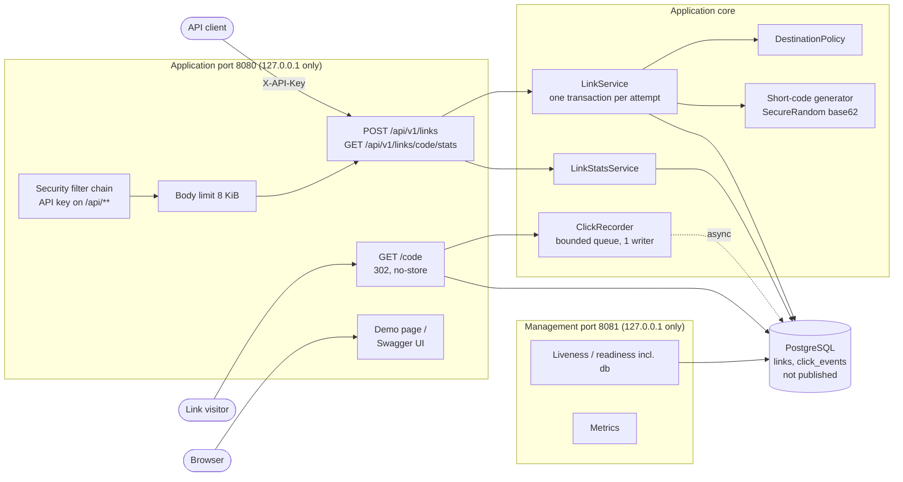
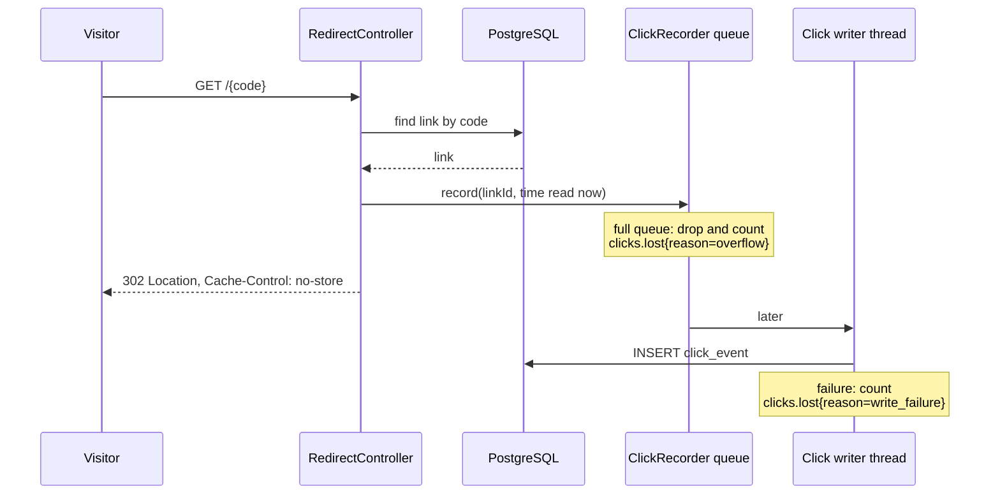
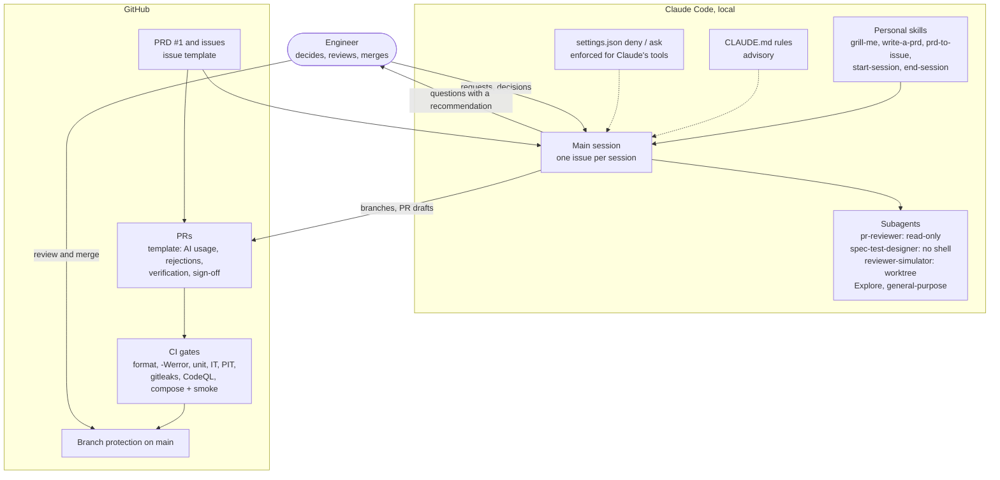

# Engineering summary

This project is a URL shortener service and the engineer-led, AI-assisted workflow that built it.
This page covers what was built and why, how it can fail and what guards against each failure,
how it was tested, what was left out, and where every artifact lives. Claims link to the issue or
pull request that holds the evidence.

- Run it: [README](../README.md). Explore it by hand: [manual testing guide](manual-testing.md).
- How AI was used and governed: [AI usage](ai-usage.md).
- The three scenarios: [greenfield](scenarios/01-greenfield.md),
  [brownfield](scenarios/02-brownfield.md), [ambiguous](scenarios/03-ambiguous.md).
- A guided tour in presentation order: [walkthrough](walkthrough.md).

## Contents

1. [Architecture: the service](#architecture-the-service)
2. [Architecture: the AI-assisted workflow](#architecture-the-ai-assisted-workflow)
3. [Key decisions](#key-decisions)
4. [Risks and failure scenarios](#risks-and-failure-scenarios)
5. [Testing approach](#testing-approach)
6. [Assumptions, limitations and trade-offs](#assumptions-limitations-and-trade-offs)
7. [Scaling path and future work](#scaling-path-and-future-work)
8. [Artifact index](#artifact-index)

## Architecture: the service

The service is one Spring Boot application (Java 21, Spring Boot 4.1.1) and one PostgreSQL 18
database, started together by Docker Compose. Docker is the only prerequisite.

**Endpoints**

| Endpoint | Port | Key | Does |
|---|---|---|---|
| `POST /api/v1/links` | 8080 | Yes | Validates the destination, stores it under a fresh 8-character code, returns `201` with `code`, `shortUrl`, `destination`, `createdAt` |
| `GET /{code}` | 8080 | No | `302` to the destination with `Cache-Control: no-store`; a `GET` records one click, a `HEAD` doesn't |
| `GET /api/v1/links/{code}/stats` | 8080 | Yes | Clicks per UTC day over an inclusive date range (default: the 30 days ending today; at most 366), plus the total |
| `/` and `/swagger-ui/index.html` | 8080 | No | The demo page ([#41][i41]) and the interactive API docs |
| `/actuator/health/{liveness,readiness}`, `/actuator/metrics` | 8081 | No | Health (readiness includes the database) and metrics; no other actuator endpoint is exposed |

**Code layout.** One package per feature under `io.github.ianverderame.urlshortener`
([#35][i35]): `link` (create, destination policy, codes, storage), `redirect` (the public hot
path), `analytics` (click recording and stats), `security` (API key and filter chain), `web`
(problem responses, Tomcat error valve, body limit) and `management` (management-port
configuration). Each package's `package-info.java` states what it may depend on; there are no
cycles.

**Data.** Two tables, created by additive Flyway migrations:

- `links`: an internal identity key, the unique `code`, the exact validated `destination`, and
  `created_at`.
- `click_events`: only a link reference and the time it happened, indexed by
  `(link_id, occurred_at)`. No IP address, user agent or referrer is stored.

**The redirect and its click.** The redirect is the hot path, so it only queues the click; another
thread writes it:

**Errors.** Every failure is an RFC 7807 problem (`application/problem+json`), including ones
Tomcat answers itself before Spring runs, on both ports ([#5][i5], [#7][i7]). The service's own
errors extend `web.ProblemException` and carry a fixed, safe `detail`: no submitted URL, key or
request body appears in a response or a log.

**Runtime.** The app runs from a multi-stage image on a JRE, as a non-root user and in UTC. Its
exec-form entrypoint lets the JVM receive SIGTERM directly. Compose publishes both app ports on
`127.0.0.1` only and doesn't publish PostgreSQL at all. The compose file holds a clearly labeled local demo key, which
the app refuses outside the `local` profile.

## Architecture: the AI-assisted workflow

The second half of the system is the workflow that produced the service: an engineer directing
Claude Code, with guardrails at three levels (instructions, tool permissions, and GitHub) and an
audit record per change.

**Tools.** Claude Code was the only AI tool. The engineer's personal skills (not committed) ran the
planning and each session's start and close. Three project subagents are committed in
`.claude/agents/`; Claude Code's built-in `Explore` and `general-purpose` agents did read-only
analysis, drafting, experiments and parallel slices.

**Execution approach.**

- **Requirements first.** The plan was stress-tested with `/grill-me`, written up as a PRD
  ([#1][i1]), challenged by an AI design review that the engineer triaged on the issue, then
  sliced into vertical issues with `/prd-to-issue`.
- **Guardrails before code.** The first commit of [#2][i2] held only AI configuration; quality
  gates and branch protection ([#3][i3]) were required before the first feature.
- **One issue per session.** Each session writes the failing test first, then the code, runs
  `./mvnw verify`, gets a fresh-context review from `pr-reviewer`, and opens a PR whose description
  records the AI usage as it happened.
- **The engineer owns decisions and merges.** Open questions went to the engineer as explicit
  choices with a recommendation; every merge was the engineer's.

**Control flow.** The per-issue loop, from issue to merge, is diagrammed in
[AI usage → The workflow](ai-usage.md#the-workflow). Its guardrails, their enforcement and their
limits are in [AI usage → Guardrails](ai-usage.md#guardrails-and-their-limits).

## Key decisions

| Decision | Rationale | Where |
|---|---|---|
| Java 21 and Spring Boot 4.1.1, with every framework idiom confirmed at setup | Boot 4 differs from the Boot 3 habits in most training data (modular starters, Jackson 3, Testcontainers 2, Security 7). Each idiom was confirmed, some with throwaway probe projects, and recorded in `CLAUDE.md` | [#2][i2], [PR #12][pr12] |
| PostgreSQL as the only stateful dependency; plain JDBC (`JdbcClient`), not JPA; additive-only Flyway migrations | SQL and transaction boundaries stay explicit and reviewable; an application rollback never meets an incompatible schema | PRD [#1][i1] |
| 8-character base62 codes from `SecureRandom`; a unique constraint; `INSERT … ON CONFLICT DO NOTHING RETURNING`; up to 3 attempts, then `503` and a metric | Codes can't be enumerated (62^8 ≈ 2.2 × 10^14); a collision is resolved by the database, not a read-then-write race; exhaustion is visible | [#4][i4], [PR #16][pr16] |
| Each create attempt in its own transaction | If the database hangs after the INSERT is sent, a `503` must not still store the link when it resumes | [#39][i39], [PR #40][pr40] |
| `302` with `Cache-Control: no-store` | Every visit reaches the service, so every click can be counted | PRD [#1][i1] |
| Health and metrics on a separate management port | No application route or short code can shadow an operational endpoint; both ports are loopback-only under compose | [#2][i2], [#25][i25] |
| An API key in the `X-API-Key` header, compared as SHA-256 digests in constant time; the app refuses to start without a key, with a short or non-printable key, or with the published demo key outside `local` | Creating links and reading stats must not be anonymous (no open redirector); a convenience default can never reach a real environment. OAuth2/OIDC is the documented production upgrade | [#5][i5], [PR #18][pr18], [#7][i7] |
| A strict destination policy: `http` or `https`, at most 2,048 characters, and a host; no whitespace, control characters or userinfo; no non-ASCII or punycode host; never the shortener's own host. The exact validated string is stored and redirected to | Blocks phishing tricks and header injection, and leaves no gap between what was validated and what is redirected to. IP literals are accepted on purpose: nothing is ever fetched, so there is no server-side request forgery | [#6][i6], [PR #20][pr20] |
| Short URLs built from a configured base URL, never from request headers | A forged `Host` header can't change the links the service hands out | [#4][i4] |
| Click events hold only the link and the time; recorded asynchronously on a bounded pool, at most once, with every loss counted by reason | Analytics never accumulate personal data and never slow or break a redirect; their incompleteness is measurable | [#8][i8], [PR #30][pr30] |
| "Make it reliable" normalized into four SLOs before any reliability code: a `503` within 3 s when the database is down or hung, readiness within 2 s, a clean exit inside the 30 s grace period, and counted analytics loss | `v0.1.0`'s failure behavior was measured first, then the engineer decided each candidate; rate limiting was rejected for now | [#9][i9], [03-ambiguous.md](scenarios/03-ambiguous.md) |
| Fail fast through configuration: 1 s connection timeout, 0.5 s validation, 1 s socket timeout | Meets the 3 s and 2 s bounds with no new dependency; the cost is that every query, including migrations and the stats aggregation, must stay well under 1 s | [#24][i24], [PR #34][pr34] |
| Request bodies capped at 8 KiB before parsing; unknown JSON properties rejected | A key holder can't make the service parse a huge body, and a misspelled field name is rejected instead of silently ignored | [#26][i26], [PR #32][pr32] |
| One package per feature, with stated dependencies | Room to grow along feature lines; it also removed a component-scan workaround that the flat package had forced | [#35][i35], [PR #37][pr37] |
| The demo page as a same-origin static file, not a separate container | It needs no CORS, so CSRF can stay off and `CsrfAssumptionsIT` still holds; no new image to pin | [#41][i41], [PR #42][pr42] |
| The demo page asks the user to paste the key | The page never contains a key, so it can't leak one or serve the published demo key from a real deployment | [#41][i41], [PR #42][pr42] |
| The demo page as a recorded scope exception | The PRD put any UI out of scope; the engineer made a deliberate exception during the backlog freeze and [recorded it on #1][i1ui] | [#41][i41] |
| No cache, message broker or extra infrastructure | Prototype scale; the app tier is stateless, and each scaling step is listed below with the signal that would trigger it | PRD [#1][i1] |

## Risks and failure scenarios

Each table lists a risk, the guardrail against it, and the test or check that would fail if that
guardrail broke. Tests named `*IT` run through the HTTP API against a real PostgreSQL in
Testcontainers.

### Security

| Risk | Guardrail | Validated by |
|---|---|---|
| The service becomes an anonymous open redirector for phishing | The API key is required for create and stats | `LinkCreationAuthIT`, `LinkStatsIT` |
| A path spelling (`/api/v1/%6Cinks`, `/api;x=1/v1/links`) skips the key check | Paths are matched the way Spring MVC routes them; the firewall rejects matrix parameters | `LinkCreationAuthIT` (path-spelling regressions) |
| A wrong key is accepted, or the comparison leaks timing | Digests compared with `MessageDigest.isEqual` | `ApiKeyTest`, `LinkCreationAuthIT` (same length, longer, shorter, empty). Timing itself is not measured by a test |
| The published demo key, or a weak key, reaches a real environment | Startup guard: missing, under 32 characters, non-printable, or the demo key outside `local` | `ApiKeyStartupIT` (runs the real `main`), `ApiKeyTest` |
| A malicious destination: dangerous scheme, userinfo trick, look-alike host, CR/LF injection | `DestinationPolicy` | `DestinationPolicyTest`: the adversarial table designed from the spec, every row asserting the outcome and reason; all mutants in the policy killed ([PR #20][pr20]) |
| What was validated differs from what is redirected to | The exact normalized string is stored, returned, and sent as `Location` | `DestinationPolicyIT` |
| A short link that points back at the shortener | `SELF_HOST` rejection | `DestinationPolicyTest` (aliases are not detected; see limitations) |
| Links can be enumerated | Random 8-character codes; internal IDs are never exposed | `Base62ShortCodeGeneratorTest`, `RedirectIT` (route accepts only the code format) |
| Submitted URLs, keys or bodies leak into logs or responses | Fixed problem details; create logs only the code and host | `SensitiveDataLeakIT`, `LinkStatsIT.aMalformedParameterIsNotEchoedInTheProblem` |
| Disabled CSRF becomes exploitable | Header-only auth: no cookies, sessions or CORS | `CsrfAssumptionsIT` (fails if sessions or CORS are turned on) |
| The demo page renders a destination as HTML (XSS) | Text-only rendering | `DemoPageIT.theDemoPageUsesNoHtmlSinksAndNoBrowserStorage` (source check) |
| The demo page leaks a key or sets a cookie | No key in the page; nothing stored | `DemoPageIT.theDemoPageEmbedsNoApiKey`, `theDemoPageSetsNoCookie` |
| The database, or the API with its published demo key, is reachable from the network | PostgreSQL unpublished; app ports on `127.0.0.1` only; non-root runtime | CI `reviewer-path` job, "Exposure and runtime user" step |
| An oversized body exhausts memory | 8 KiB cap before parsing, after the key check | `RequestBodyLimitIT` (including a chunked body over a raw socket), `RequestBodyLimitTest` |

### Reliability

| Risk | Guardrail | Validated by |
|---|---|---|
| The database is down: requests hang, or fail as a generic `500` | Connection and validation timeouts; a `503` problem and one log line | `DatabaseOutageIT` |
| The database hangs with a query in flight | 1 s socket timeout | `DatabaseHangIT`, `DatabaseHangAtPoolStartIT` |
| Readiness hangs or lies during an outage, or the app gets restarted for it | Readiness includes the database and answers within 2 s; liveness doesn't depend on it | `ReadinessDuringOutageIT`; stop/start recovery verified by hand ([manual testing](manual-testing.md#13-database-outage-and-recovery)) |
| A `503` from a hang still stores the link | One transaction per create attempt | `LinkServiceTest` pins that the insert runs in a transaction; no test reaches the hang-then-resume path itself |
| Shutdown overruns the grace period and the JVM is killed | A 7 s / 3 s shutdown budget for the two contexts, inside 30 s | `ShutdownTimeoutBudgetIT`; CI checks C1b (under load, every `201` found in the database), C2 and C3 (database hung) |
| Click recording slows the redirect | Asynchronous bounded pool | `ClickRecordingBackpressureIT`: the only worker is held on a latch and the redirect must still return `302` |
| A full queue or a failed write breaks the redirect | Drop and count by reason; never throw | `ClickRecordingBackpressureIT`, `ClickWriteFailureIT`, `ClickRecorderTest` |
| Code collisions | Database uniqueness, retry, then `503` and a metric | `LinkCreationCollisionIT` |
| An error Tomcat answers itself comes back as an HTML page | A replacement error valve on both ports | `ErrorContractIT` (raw socket) |

### The AI-assisted workflow

The risks specific to building with AI (invented versions, outdated framework knowledge,
plausible but wrong code, tests that can't fail, leaked secrets, scope creep, overclaiming, an AI
reviewer that is itself wrong, actions with outside effects, and parallel sessions interfering)
are mapped to their countermeasures, each with the real case that tested it, in
[AI usage → Pitfalls and countermeasures](ai-usage.md#pitfalls-and-countermeasures).

## Testing approach

- **Test first.** Every behavior started as a failing test and every bug fix as a failing
  regression test (`CLAUDE.md` rule 2). Where a new test passed at once, the code it protects was
  deliberately broken to show the test could fail.
- **Through public interfaces, with real dependencies.** Integration tests drive the HTTP API
  against PostgreSQL in Testcontainers, pinned to the same image as compose. Unit tests cover the
  deep modules (destination policy, link service, code generator, click recorder, stats service)
  with in-memory fakes at the persistence boundary, not mocks of internal collaborators.
- **Designed from the spec.** The destination policy's adversarial table was drafted by
  `spec-test-designer` from the PRD alone, before any policy code existed; its 12 open questions
  were the engineer's to answer ([PR #20][pr20]).
- **Mutation testing as a gate.** PIT runs on the unit tests, and its CI job fails below 85% (it is not one of
  the checks branch protection requires, so it is visible rather than merge-blocking). The score was
  80% at `v0.1.0`, reached 85% in [#7][i7], and was 88.2% as of [PR #40][pr40]. The threshold has
  never been lowered.
- **Injected time, no sleeps.** Business time (UTC days, the default range) comes from an injected
  `Clock`. The performance guard holds the click writer on a latch instead of timing anything; its
  timeout is only a hang backstop. The reliability tests do measure real elapsed time, because
  their SLOs are upper bounds (a `503` within 3 s, readiness within 2 s, the shutdown phase within
  5 s). No test sleeps.
- **End to end on every change.** CI's `reviewer-path` job builds from a clean checkout, starts
  the compose stack, runs the smoke test, checks port exposure and the runtime user, and runs the
  three shutdown scenarios. The same smoke test is what an evaluator runs.
- **By hand.** Every feature was exercised manually against the compose stack, and the run became
  the [manual testing guide](manual-testing.md). The engineer walked through the demo page in
  [PR #42][pr42].
- **Current size.** `./mvnw verify` on this branch: 496 unit tests and 154 integration tests,
  all passing, plus the formatting and `-Xlint:all -Werror` checks.

## Assumptions, limitations and trade-offs

**Assumptions** (from the PRD):

- All API-key holders are equally trusted; there are no per-user accounts or link ownership.
- Clients are services, not browsers, so there is no CORS. The demo page is same-origin.
- Prototype scale, on one instance.

**Limitations**, stated plainly:

- **Reliability gaps** ([03-ambiguous.md](scenarios/03-ambiguous.md#validation)):
  - On shutdown, queued clicks are counted as lost rather than flushed. The drain ([#28][i28])
    was descoped, and the analytics-loss SLO has no target ratio yet.
  - The main context's 7 s shutdown share has never been tested with a hanging bean.
  - The just-used-connection path (2.5 s worst case) isn't exercised by a test.
  - Database recovery after a real stop and start is verified only by hand.
  - The `503` bounds were tested against Testcontainers, not against an outage of the compose stack.
- **Performance is guarded, not measured.** One deterministic check runs on every change (the
  redirect stays `302` while the click writer is blocked), and latency is bounded under failure.
  There is no measured latency or throughput for the normal path, no gate for a slowdown that
  stays under the 1 s query cap, and no load test. A test asserting the redirect and stats queries
  use their indexes would be a deterministic next step
  ([requirements coverage](requirements-coverage.md#where-coverage-is-thinner)).
- **A replaced exception's type isn't logged.** When a failed rollback replaces a query's
  exception, only the replacement is logged ([#24][i24]).
- **Click writes are autocommitted**, so after a hang `clicks.lost{reason=write_failure}` can count
  a click that was in fact stored ([#39][i39]).
- **The 1 s socket timeout caps every query**, including Flyway migrations and the stats
  aggregation. A Flyway-specific timeout is future work.
- **Self-host detection is name-based.** Under compose, every `localhost` destination is rejected,
  but another name for the same host (`127.0.0.1`, a DNS alias) is not detected.
- **Form-encoded bodies** on `PUT`/`PATCH`/`DELETE` are parsed by Spring before the key check
  ([#31][i31], frozen as future work).
- **Error and docs polish**, found in the manual run: a code of the wrong length gets Spring's own
  404 wording ("No static resource"); the OpenAPI problem schema shows extra fields nested under
  `properties`, while real responses are flat; and the OpenAPI `503` description omits the
  database-outage case.
- **The demo page** has no automated browser test (Playwright was rejected as a new dependency;
  a source check and a manual walkthrough cover it), hard-codes management port 8081, and browsers
  may offer to save the pasted key as a password.
- **Tests:** log-capture tests see all threads, so an unrelated warning could fail one; test log
  timestamps show the host's offset, not UTC; three stats-range rules have no dedicated test;
  each test class with its own database starts its own context, which slows the suite.
- **No enforcement of package boundaries** beyond the stated rules (Spring Modulith or ArchUnit
  would be a new dependency).

**Trade-offs**, chosen deliberately:

| Chose | Over | Because |
|---|---|---|
| At-most-once, best-effort analytics | Exactly-once delivery | The redirect must never wait on analytics; losses are counted instead |
| Configuration-only timeouts | A custom readiness indicator or new libraries | No new dependencies; the cost is the global 1 s query cap |
| A strict, reject-don't-repair URL policy | Trimming, re-encoding, IDN support | The stored string is exactly what was validated; look-alike hosts can't get in |
| A static API key | OAuth2/OIDC | Fits a single trusted operator; OAuth2 is the production upgrade |
| Plain JDBC | JPA | Explicit SQL and transactions, which the reliability work depended on |
| Fixing the record and the template | Leaving early PR sign-offs as they were | Honest audit trail; see [AI usage → Known gaps](ai-usage.md#known-gaps-in-the-record) |

## Scaling path and future work

### Scaling path

The app tier holds no state that needs sharing, so the first steps are operational. Each step is
taken when its signal appears, not before.

| Step | Trigger |
|---|---|
| Run several app instances behind a load balancer | One instance's CPU or request latency is the bottleneck. Each instance has its own click queue, so loss counts become per instance |
| Cache redirect lookups (links never change after creation) | Redirect reads dominate database load |
| Batch click writes | The click writer can't keep up and `clicks.lost{reason=overflow}` grows |
| A daily stats rollup instead of aggregating raw events | Stats queries approach the 1 s socket timeout |
| Partition `click_events` by time, then read replicas | Click volume makes the table or its index the bottleneck |
| Rate limiting per key | A key holder can create links faster than is reasonable (rejected for now on [#9][i9]) |
| OAuth2/OIDC instead of a shared key | More than one trusted operator |
| Share test application contexts | The integration suite becomes too slow to run on every change |

### Future work

Everything the PRD put out of scope remains out of scope:

- User accounts, per-user ownership, or any UI beyond the demo page ([#41][i41])
- Custom aliases, link editing, disabling or deletion
- Link expiry (cut while slicing the PRD; [recorded on #1][i1expiry])
- A link metadata endpoint
- Deduplication of identical destinations (each submission gets its own link)
- Referrer, user-agent, IP or geo analytics; bot filtering
- Blocking IP-literal destinations; internationalized domain names
- Caching, read replicas, sharding, multi-region, event streaming, exactly-once analytics
- Malware or phishing reputation checks
- OAuth2/OIDC
- Hosted deployment and load testing

Building it added more: the click drain and loss-ratio target ([#28][i28]), rate limiting, and
every limitation listed above.

## Artifact index

**Requirements and plan**

| Artifact | What it is |
|---|---|
| [PRD #1][i1] | Problem, user stories, decisions, testing decisions, out of scope; the AI design review and its triage, the expiry cut and the demo-page exception are in its comments |
| Issues [#2][i2]–[#41][i41] | One per slice, each with intent, constraints, technical context and acceptance criteria |
| [`PROGRESS.md`](../PROGRESS.md) | The hand-off between sessions |

**Code**

| Artifact | What it is |
|---|---|
| [`link/`](../src/main/java/io/github/ianverderame/urlshortener/link/) | Create API, `DestinationPolicy`, code generator, `LinkService`, JDBC repository |
| [`redirect/`](../src/main/java/io/github/ianverderame/urlshortener/redirect/) | `RedirectController` |
| [`analytics/`](../src/main/java/io/github/ianverderame/urlshortener/analytics/) | `ClickRecorder`, click writer, stats service and controller |
| [`security/`](../src/main/java/io/github/ianverderame/urlshortener/security/) | `ApiKey`, `ApiKeyAuthenticationFilter`, `SecurityConfig` |
| [`web/`](../src/main/java/io/github/ianverderame/urlshortener/web/) | Problem responses, the Tomcat error valve, the body limit |
| [`management/`](../src/main/java/io/github/ianverderame/urlshortener/management/) | The management context's shutdown timeout |
| [`index.html`](../src/main/resources/static/index.html) | The demo page |
| [`application.properties`](../src/main/resources/application.properties) | Timeouts, shutdown budget, management exposure, each with its reasoning |
| [Migrations](../src/main/resources/db/migration/) | `V1` links, `V2` click events |

**Tests** ([`src/test/java`](../src/test/java/io/github/ianverderame/urlshortener/))

| Area | Tests |
|---|---|
| Destination policy | `DestinationPolicyTest` (adversarial table), `DestinationPolicyIT` |
| Create and redirect | `LinkCreationIT`, `LinkCreationValidationIT`, `LinkCreationCollisionIT`, `LinkServiceTest`, `RedirectIT`, `Base62ShortCodeGeneratorTest`, `PublicBaseUrlTest` |
| Security | `LinkCreationAuthIT`, `ApiKeyStartupIT`, `ApiKeyTest`, `CsrfAssumptionsIT`, `SensitiveDataLeakIT`, `DemoPageIT` |
| Errors | `ErrorContractIT`, `ProblemDetailsAdviceTest`, `ProblemErrorReportValveTest`, `RequestBodyLimitIT` |
| Analytics | `ClickCaptureIT`, `ClickRecordingBackpressureIT` (performance guard), `ClickWriteFailureIT`, `ClickRecorderTest`, `LinkStatsIT`, `LinkStatsServiceTest`, `ClickEventsSchemaIT` |
| Reliability | `DatabaseOutageIT`, `DatabaseHangIT`, `DatabaseHangAtPoolStartIT`, `ReadinessDuringOutageIT`, `ShutdownTimeoutBudgetIT` |
| Operations and docs | `HealthIT`, `MetricsIT`, `ApiDocsIT`, `ManagementContextScanIT` |

**Run, gates and AI configuration**

| Artifact | What it is |
|---|---|
| [`compose.yaml`](../compose.yaml), [`Dockerfile`](../Dockerfile) | The one-command run path |
| [`smoke/smoke.sh`](../smoke/smoke.sh) | The end-to-end smoke test |
| [`.github/workflows/ci.yml`](../.github/workflows/ci.yml), [`codeql.yml`](../.github/workflows/codeql.yml), [`dependabot.yml`](../.github/dependabot.yml) | CI gates |
| [`.gitleaks.toml`](../.gitleaks.toml) | Secret scanning; one allowlist entry, the demo key |
| [`CLAUDE.md`](../CLAUDE.md), [`.claude/settings.json`](../.claude/settings.json), [`.claude/agents/`](../.claude/agents/) | AI rules, permission rules, subagents |
| [Issue template](../.github/ISSUE_TEMPLATE/work-item.md), [PR template](../.github/pull_request_template.md) | The work-item and audit-record formats |

**Documents**

| Document | What it is |
|---|---|
| [README](../README.md) | Run, smoke test, demo page, API examples, destination rules, SLOs |
| [Manual testing guide](manual-testing.md) | Every feature by hand, with expected output |
| [AI usage](ai-usage.md) | Workflow, guardrails, subagents, pitfalls, rejected output, the experiment |
| [Greenfield](scenarios/01-greenfield.md), [brownfield](scenarios/02-brownfield.md), [ambiguous](scenarios/03-ambiguous.md) | Decomposition, execution and validation per scenario |
| [Walkthrough](walkthrough.md) | A guided tour in presentation order |
| [Requirements coverage](requirements-coverage.md) | Each requirement of the brief mapped to its evidence |

**Pull requests**, in order: [#12][pr12] guardrails and skeleton, [#13][pr13] quality gates
([#14][pr14] the gate demo, never merged), [#15][pr15] Mockito agent, [#16][pr16] tracer bullet,
[#18][pr18] auth and error contract, [#20][pr20] URL policy and the experiment, [#21][pr21]
review of `v0.1.0`, [#22][pr22] scanning-alert rule, [#23][pr23] OpenAPI, [#29][pr29] reliability
decomposition, [#30][pr30] click analytics, [#32][pr32] body limits, [#33][pr33] metrics and SLOs,
[#34][pr34] fail fast, [#36][pr36] shutdown budget, [#37][pr37] feature packages, [#38][pr38]
reliability close-out, [#40][pr40] review cleanup, [#42][pr42] demo page.

[i1]: https://github.com/ianverderame/url-shortener-ai-assisted/issues/1
[i1expiry]: https://github.com/ianverderame/url-shortener-ai-assisted/issues/1#issuecomment-6136948155
[i1ui]: https://github.com/ianverderame/url-shortener-ai-assisted/issues/1#issuecomment-6163316317
[i2]: https://github.com/ianverderame/url-shortener-ai-assisted/issues/2
[i3]: https://github.com/ianverderame/url-shortener-ai-assisted/issues/3
[i4]: https://github.com/ianverderame/url-shortener-ai-assisted/issues/4
[i5]: https://github.com/ianverderame/url-shortener-ai-assisted/issues/5
[i6]: https://github.com/ianverderame/url-shortener-ai-assisted/issues/6
[i7]: https://github.com/ianverderame/url-shortener-ai-assisted/issues/7
[i8]: https://github.com/ianverderame/url-shortener-ai-assisted/issues/8
[i9]: https://github.com/ianverderame/url-shortener-ai-assisted/issues/9
[i24]: https://github.com/ianverderame/url-shortener-ai-assisted/issues/24
[i25]: https://github.com/ianverderame/url-shortener-ai-assisted/issues/25
[i26]: https://github.com/ianverderame/url-shortener-ai-assisted/issues/26
[i28]: https://github.com/ianverderame/url-shortener-ai-assisted/issues/28
[i31]: https://github.com/ianverderame/url-shortener-ai-assisted/issues/31
[i35]: https://github.com/ianverderame/url-shortener-ai-assisted/issues/35
[i39]: https://github.com/ianverderame/url-shortener-ai-assisted/issues/39
[i41]: https://github.com/ianverderame/url-shortener-ai-assisted/issues/41
[pr12]: https://github.com/ianverderame/url-shortener-ai-assisted/pull/12
[pr13]: https://github.com/ianverderame/url-shortener-ai-assisted/pull/13
[pr14]: https://github.com/ianverderame/url-shortener-ai-assisted/pull/14
[pr15]: https://github.com/ianverderame/url-shortener-ai-assisted/pull/15
[pr16]: https://github.com/ianverderame/url-shortener-ai-assisted/pull/16
[pr18]: https://github.com/ianverderame/url-shortener-ai-assisted/pull/18
[pr20]: https://github.com/ianverderame/url-shortener-ai-assisted/pull/20
[pr21]: https://github.com/ianverderame/url-shortener-ai-assisted/pull/21
[pr22]: https://github.com/ianverderame/url-shortener-ai-assisted/pull/22
[pr23]: https://github.com/ianverderame/url-shortener-ai-assisted/pull/23
[pr29]: https://github.com/ianverderame/url-shortener-ai-assisted/pull/29
[pr30]: https://github.com/ianverderame/url-shortener-ai-assisted/pull/30
[pr32]: https://github.com/ianverderame/url-shortener-ai-assisted/pull/32
[pr33]: https://github.com/ianverderame/url-shortener-ai-assisted/pull/33
[pr34]: https://github.com/ianverderame/url-shortener-ai-assisted/pull/34
[pr36]: https://github.com/ianverderame/url-shortener-ai-assisted/pull/36
[pr37]: https://github.com/ianverderame/url-shortener-ai-assisted/pull/37
[pr38]: https://github.com/ianverderame/url-shortener-ai-assisted/pull/38
[pr40]: https://github.com/ianverderame/url-shortener-ai-assisted/pull/40
[pr42]: https://github.com/ianverderame/url-shortener-ai-assisted/pull/42
